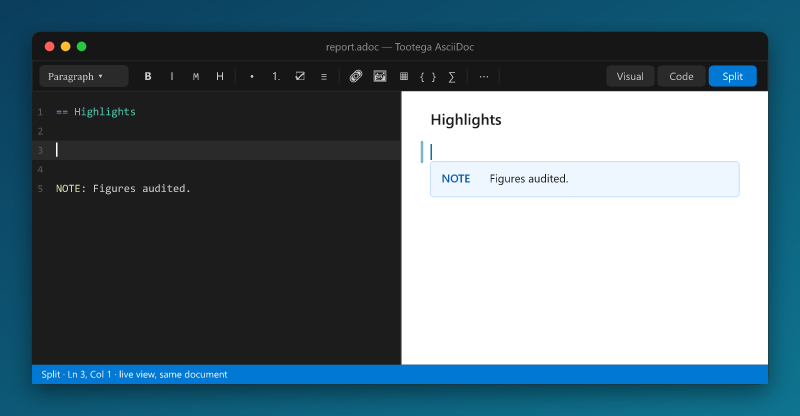
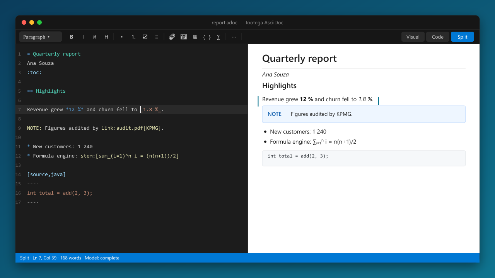
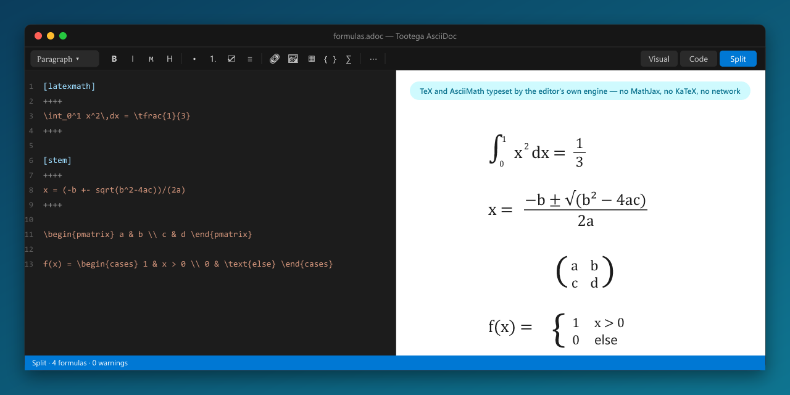
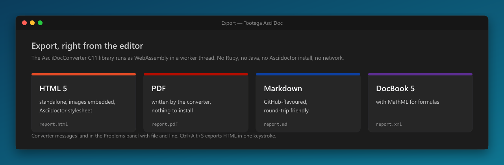

  

<h1 align="center">Tootega AsciiDoc</h1>

  <b>The complete AsciiDoc editor for Visual Studio Code.</b> 
  WYSIWYG, code and split editing on one document · live view · typeset formulas · export to HTML, PDF, Markdown and DocBook —
  all inside VS Code, nothing to install, nothing sent anywhere.

  

---

## Why Tootega AsciiDoc

Most AsciiDoc tooling for VS Code gives you a text editor and a preview. Tootega AsciiDoc gives you an **editor**:
you can write in a rich view, in the source, or in both at once, and the document underneath is always the same
`.adoc` file — saved, diffed and versioned by VS Code like any other text file.

| | |
|---|---|
| **Three modes, one document** | *Visual* (WYSIWYG), *Code* (highlighted AsciiDoc with find/replace and go-to-line) and *Split* (both, side by side, editable on either side). Switch at any time; nothing is converted, nothing is lost. |
| **A cursor that works both ways** | In Split mode the side you are not typing in shows a ghost caret where you are. Click in the view and the code follows; move in the code and the view scrolls to the spot. |
| **The toolbar is the same everywhere** | Bold, lists, headings, tables, links, images, admonitions, footnotes, anchors, formulas… every button works in the visual editor **and** as a text edit in the code editor. |
| **Formulas typeset for real** | `stem`, `latexmath` and `asciimath` are rendered by the extension's own TeX/AsciiMath engine into MathML — live in the editor and in your HTML/DocBook exports. |
| **Export without a toolchain** | HTML 5, PDF, Markdown and DocBook 5 come from a C library compiled to WebAssembly and run in a worker thread. No Ruby, no Java, no Asciidoctor install, no network, no telemetry. |
| **Native VS Code citizen** | Grammar, snippets, outline, folding, links, hover, completion, image paste, diagnostics in the Problems panel, side preview with two-way scroll sync, settings in your language. |
| **Bilingual** | Brazilian Portuguese and international English, following your VS Code display language. |

## The editor

  

- **Visual mode** edits the document as you will read it: headings, paragraphs, lists (bulleted, numbered, tasks,
  description), tables with row/column tools, admonitions, examples, sidebars, quotes, code blocks with highlighting
  and a language selector, images resolved against `:imagesdir:`, includes shown as blocks you can open, formulas,
  comments, attributes — every AsciiDoc block has a place on screen and round-trips back to the same source.
- **Code mode** is a real AsciiDoc editor: syntax highlighting, bracket pairs, find/replace with regex, go to line,
  and the same toolbar acting on the text (`Ctrl+B`, `Ctrl+I`, `Ctrl+K`, list and heading shortcuts).
- **Split mode** shows both over the same document. Edit on either side; the other updates in a moment, with the
  shared cursor keeping your place.
- **Structure panel** with the heading tree, **undo/redo across modes**, and contained dialogs for links, images
  (with width/height), tables, cross references (with the document's anchors suggested), footnotes, attributes,
  keyboard/button/menu macros, anchors and formulas (with a live preview).
- **Nothing is lost**: what the visual model does not represent is carried as written — list styles, block options,
  roles, attribute lines — so a document edited in Visual mode serializes back to the AsciiDoc you would have typed.

## Formulas, the honest way

  

The math engine is written for this editor: a TeX lexer, macro expander (`\def`, `\newcommand`, `\let`, delimited
parameters…), recursive-descent parser, a symbol table of about 1 000 math and 650 text commands, the full function
and environment surface you expect from KaTeX (fractions, roots, accents, sized delimiters, big operators with
limits, matrices, `cases`, `align`, `gather`, `equation`, extensible arrows, colour, styles, phantoms, enclosures,
tags…) and an AsciiMath parser to the same tree. The output is **MathML Core**, laid out by VS Code's own renderer,
with Latin Modern Math shipped in the package so formulas look the same on Windows and Linux.

No third-party math library is bundled or downloaded. The engine is checked against KaTeX's MathML as a test oracle
(289 of 328 corpus formulas structurally identical, every remaining difference documented); unknown commands render
as marked errors with a readable warning — never silently.

## Export

  

Export from the title bar, the context menu or `Ctrl+Alt+S` (HTML). The converter is the
[AsciiDocConverter](https://github.com/HermesSilva/AsciiDocConverter) C11 library compiled to WebAssembly and run in a
worker thread, so the editor never freezes and the same bytes produce the same output on every platform.

- **HTML 5** — standalone, Asciidoctor stylesheet, images embedded as data URIs, formulas as MathML, optional
  custom stylesheet.
- **PDF** — written directly by the converter; page size configurable; nothing else to install.
- **Markdown** — GitHub-flavoured.
- **DocBook 5** — with `<inlineequation>`/`<informalequation>` MathML.

Converter messages (with file and line) go to the Problems panel; the output can open automatically.

## Performance and footprint

- **Local and offline.** Parsing, rendering, formulas and export all run inside VS Code. No service calls.
- **Instant feedback.** The visual model updates per keystroke; the split view re-parses with a short debounce so
  typing stays smooth on long documents; the code editor virtualises long files.
- **Light.** One `.vsix` of about 3 MB, including the WebAssembly converter and the math font. The webview bundles a
  single React and the engine's stylesheet; the host is one file.
- **Safe by construction.** The webview runs under a strict Content Security Policy; export reads only inside your
  workspace unless you allow otherwise; the extension never writes to a file you did not ask for.

## Commands

| Command | What it does |
|---|---|
| **New AsciiDoc document** | File › New File… or the palette: creates a file with a skeleton in your language and opens it in the editor. |
| **Edit full elements sample** | Opens an editable copy of a complete sample covering every AsciiDoc element — the fastest tour of the editor. |
| **Open with Tootega / Show source** | Switch between the Tootega editor and the native text editor. |
| **Visual / Code / Split**, **Toggle structure** | Editor modes and the heading panel. |
| **Preview to the side**, **Lock preview**, **Refresh** | Live view next to the native editor (`Ctrl+K V`), scroll-synced both ways. |
| **Export to HTML / PDF / Markdown / DocBook** | Also in the editor title bar and the Explorer context menu. |
| **AsciiDoc cheat sheet** | The syntax the editor reads and writes, in your language. |

Settings live under `tootegaAsciidoc.*` (default mode, language, preview sync, image paste folder, export options, PDF
page size, diagnostics and more), with descriptions in Portuguese and English.

## Compatibility

- VS Code 1.97 or later, Windows and Linux (macOS works where VS Code runs; the math font is bundled, so no system
  font is required).
- File types: `.adoc`, `.asciidoc`, `.asc`, `.ad` — Tootega is the default editor; "Reopen With…" gives you the text
  editor at any time.
- Installs alongside the official Asciidoctor extension (both contribute the `asciidoc` language; "Reopen With…"
  picks the editor for a file).

## Contributing and building

Development notes, architecture and the build/packaging rules are in
[`Docs/DEVELOPMENT.md`](https://github.com/HermesSilva/TootegaAsciiDoc/blob/master/Docs/DEVELOPMENT.md). The editor
engine is the open [TootegaWebUI](https://github.com/HermesSilva/TootegaWebUI) repository; the converter is
[AsciiDocConverter](https://github.com/HermesSilva/AsciiDocConverter).

## License

MIT — © Tootega Pesquisa e Inovação. Latin Modern Math is distributed under the GUST Font License (see
`media/fonts/GUST-FONT-LICENSE.txt`).
